<div align="center">

# NotchNux

### A dynamic, macOS-style **Notch** and dashboard for GNOME Shell

A pill that lives at the top of your screen, morphs to show what you're doing, and springs open into a dashboard for your day: tasks, a focus timer, notes, music, calendar, weather, notifications, system controls and a file shelf.

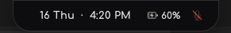

[](LICENSE)


</div>

---

## ✨ What is it?

NotchNux replaces the default GNOME top-bar clock with a **living pill**. At a glance it shows the date, time, battery and privacy (mic/camera) indicators. It hosts one **live activity** at a time — a running focus timer, or the track that's playing. When a notification arrives, the pill **morphs into a banner** with action buttons. Hover or click and it **springs open** into a dashboard that starts on **Home**: what's next today, your tasks, the focus timer and now-playing, all in one glance.


## 🧩 Features

| | Feature | What it does |
|---|---|---|
| 🏠 | **Home** | A glanceable start page: greeting and weather, your next calendar event, your top tasks with a quick-add field, the focus timer and now-playing controls. |
| ✅ | **Tasks** | A fast to-do list right under the notch. Type and press Enter to add (start with `!` to star it), click to edit, check off with a satisfying tick, review what you finished in **Done**. |
| ⏱️ | **Focus** | A Pomodoro-style timer (15 / 25 / 50 min) with automatic short and long breaks. While it runs, the countdown lives in the pill, **Do Not Disturb** turns on (optional), and you get a banner with *Start break* when time's up. Survives screen locks. |
| 📝 | **Notes** | A scratchpad that autosaves as you type. |
| 🎵 | **Music / MPRIS** | Full player with album art, a spinning vinyl, scrubber, shuffle/repeat, and a volume dial — plus a lyrics view with timed lyrics from lrclib.net that follow the song. Works with any MPRIS player (Spotify, browsers, etc.). |
| 🌤️ | **Weather** | Current conditions, an analog clock, humidity, wind, sunrise/sunset and hourly forecast. Auto-locates or set a manual location. |
| 📷 | **Studio** | Live webcam preview (GStreamer) plus video and audio-only recording, with camera/mic device selection. |
| 📅 | **Calendar** | A scrollable day strip with your events pulled from GNOME Online Accounts — scroll the dates to jump between days. |
| 🔔 | **Alerts** | Notification history, and a **peek** mode where the pill expands into a banner with action buttons the moment a notification arrives. |
| 🗂️ | **Shelf** | A click-to-browse / paste-a-file scratch space, plus **Quick Share** to send files to your phone and other paired [GSConnect](https://github.com/GSConnect/gnome-shell-extension-gsconnect) devices. |
| 🖥️ | **Tray / System** | A Control Center: Wi-Fi, Bluetooth, hotspot and airplane toggles with in-notch network and device pickers; Silence, Night Light, screenshot and lock tiles; volume and brightness sliders; device batteries; and live CPU, memory, disk and network. |
| 🏝️ | **Island alerts** | Volume, brightness, charging, low battery, headphones and a 5-minute event heads-up grow out of the pill for a moment, one at a time. |
| 🫥 | **Hide when idle** | Optional: the notch tucks into the top edge until something is live, or you rest the pointer at the top centre. |
| 🔲 | **Grid launcher** | Home plus one to eight shortcuts in the header (five by default; Preferences → Tabs → *Header shortcuts*); everything else (and the toggles) behind the grid button. Hold a tile to pick shortcuts. |
| 📋 | **Clipboard** | The last 20 text clips with search and pins. Passwords are skipped; only pinned clips are saved. |
| ⏲️ | **Stopwatch, Keep Awake, Stats** | A stopwatch with laps, a keep-awake toggle, and memory/CPU in the pill. Two-finger swipe skips tracks; right-click the pill for a quick menu. |
| 🎨 | **Theming** | Pick any accent color — the whole UI, dials and highlights recolor live. Reorder or hide dashboard tabs, and toggle individual features on/off, from a **native preferences window**. |

### Collapsed pill indicators
- 📆 Date & time (pill sizes to its content so the clock never truncates)
- 🔋 Battery percentage & charging state
- 🎤/📷 Privacy dots the moment the mic or camera is in use
- ⏱️ Focus countdown while a session runs — click it to jump to the Focus tab
- 🎶 Scrolling now-playing title while media is active

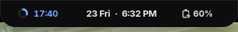

## 🖼️ Screenshots

<div align="center">

**Home** — your day at a glance
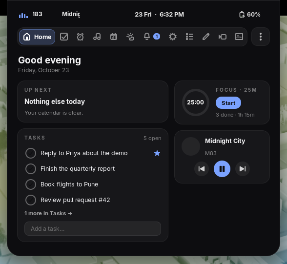

**Tasks** — quick add, star, edit in place, tick off
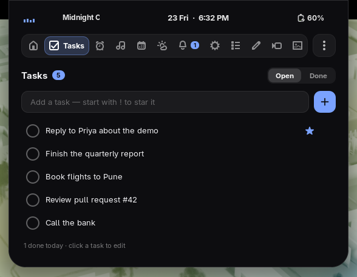

**Focus** — Pomodoro timer with breaks, do-not-disturb and today's stats
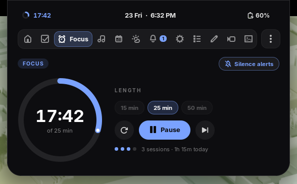

**Notes** — an autosaving scratchpad
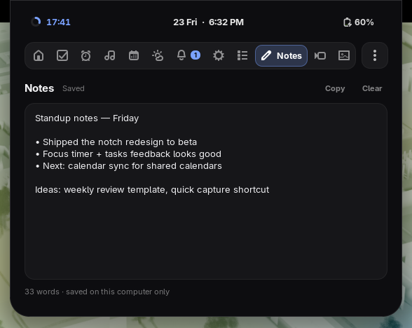

**Music** — vinyl art, scrubber, shuffle/repeat and a volume dial
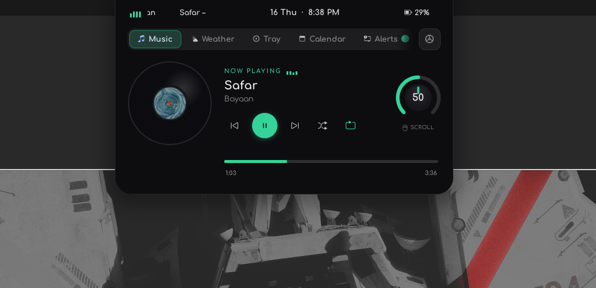

**Weather** — analog clock, current conditions and details
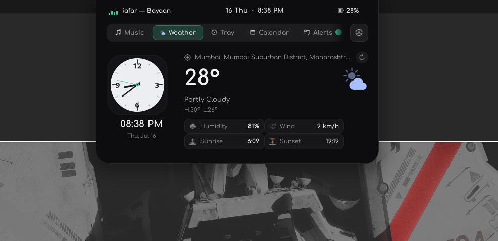

**Tray / System** — connectivity, quick tiles, volume and brightness sliders, device batteries and live system meters
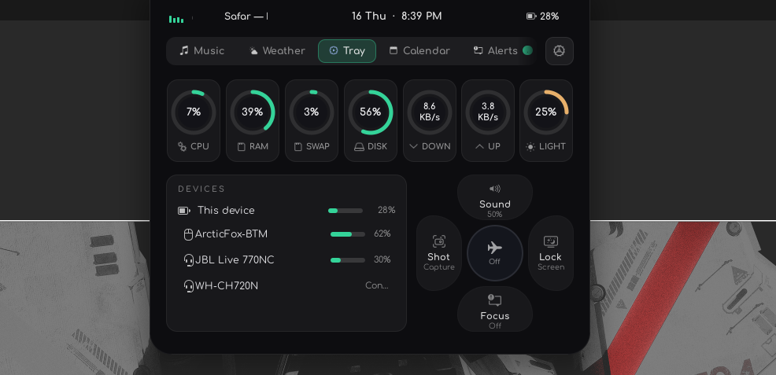

**Calendar** — a scrollable day strip with your GNOME Online Accounts events
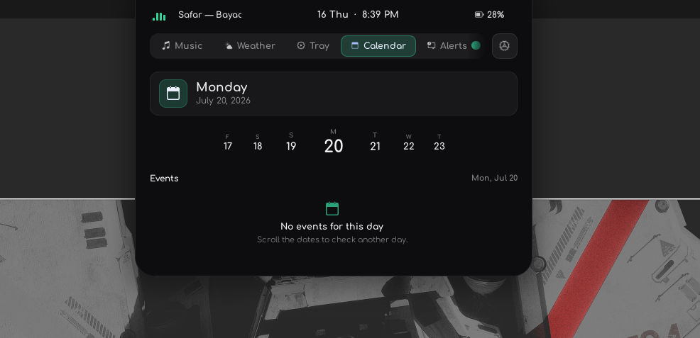

**Alerts** — grouped notification history with a live unread count
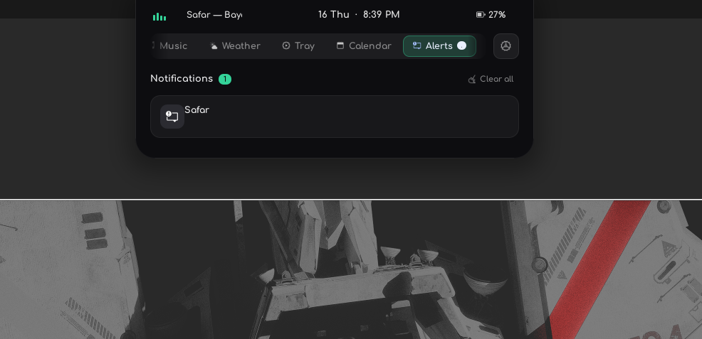

**Shelf** — a click-to-browse / paste-a-file zone with Quick Share to paired devices
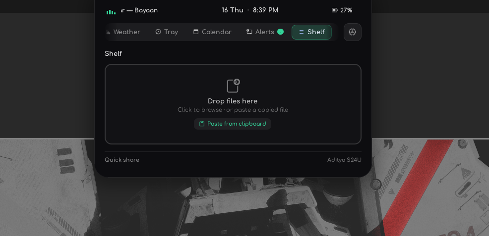

**Studio** — live webcam preview plus camera & audio recording
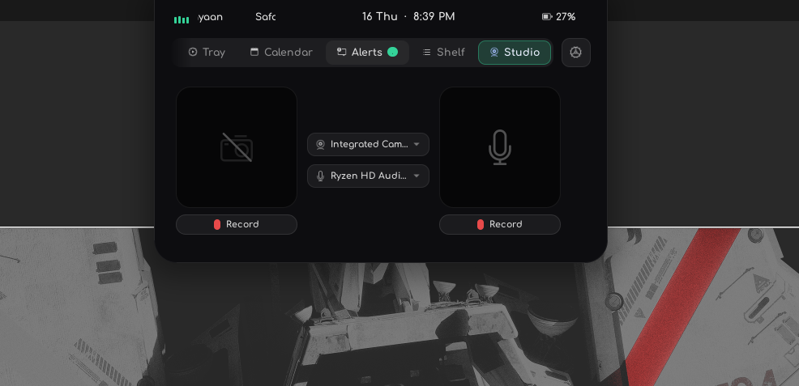

**Notification peek** — the pill smoothly expands into a banner with actions
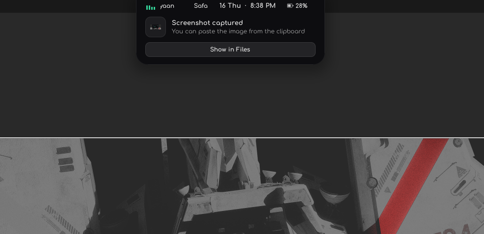

**Preferences** — a native GTK/libadwaita settings window for accent, tabs and features
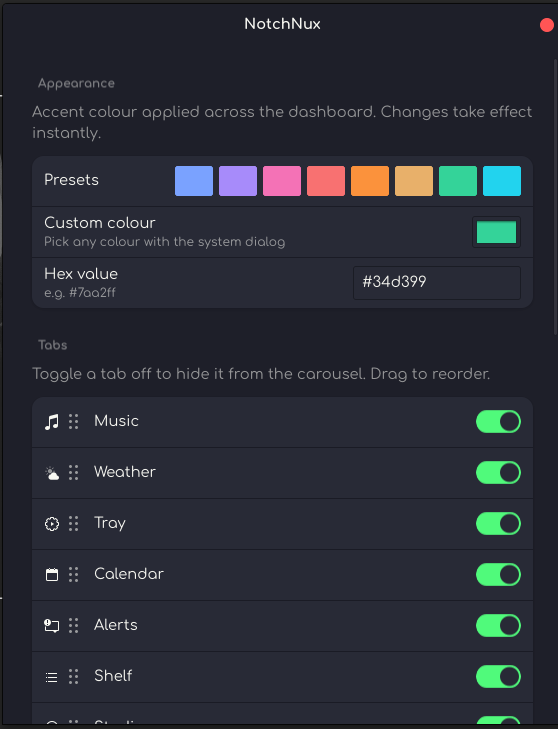

</div>

## 📦 Installation

### Requirements
- **GNOME Shell 50** (Wayland)
- `gnome-shell-extensions` (for the `gnome-extensions` CLI)
- **Optional:** GStreamer 1.0 (`gstreamer1-plugins-*` / `gstreamer1.0-plugins-*`) for the Studio webcam & recording tab

On **Fedora**:
```bash
sudo dnf install gnome-shell-extensions gstreamer1-plugins-good gstreamer1-plugins-bad-free
```

On **Ubuntu / Debian**:
```bash
sudo apt install gnome-shell-extensions gstreamer1.0-plugins-good gstreamer1.0-plugins-bad
```

### Install from source
```bash
git clone https://github.com/Adityasah2004/NotchNux.git
cd NotchNux
./install.sh
```

Then **reload GNOME Shell** so it loads the extension:
- **Wayland:** log out and log back in
- **X11:** press `Alt`+`F2`, type `r`, press `Enter`

The installer auto-enables the extension. If it couldn't, enable it manually:
```bash
gnome-extensions enable notchnux@adityasah.programs
```

### Try it without reloading your session
Run it in a separate GNOME Shell window so nothing touches your real desktop:
```bash
# GNOME 49 and newer
dbus-run-session -- gnome-shell --devkit --wayland
# GNOME 48 and older
dbus-run-session -- gnome-shell --nested --wayland
```

## 🕹️ Usage

- **Hover or click the pill** to open the dashboard; click outside to collapse it.
- **Switch tabs** with the icon rail at the top (or scroll over it). Each tab keeps its place, so switching back is instant.
- **Type right in the notch** — the Tasks and Notes fields take the keyboard while focused; `Esc` hands it back.
- **Open preferences** (⋯ → *NotchNux Settings…* in the dashboard, or `gnome-extensions prefs notchnux@adityasah.programs`) to change the accent color, reorder or hide tabs, and toggle features. Changes apply to the live notch instantly — no shell reload needed.

Configuration is stored as plain JSON under `~/.config/notchnux/config.json` — no GSettings schema required. The preferences window and the running notch share this file, so edits made in either place take effect immediately.

## ⚙️ Configuration & data locations

| Path | Contents |
|---|---|
| `~/.config/notchnux/config.json` | Accent color, tab order & visibility, feature toggles |
| `~/.config/notchnux/settings.json` | Weather location and the last forecast |
| `~/.local/share/notchnux/tasks.json` | Your tasks |
| `~/.local/share/notchnux/notes.md` | Your notes |
| `~/.local/share/notchnux/focus.json` | Focus timer state and today's stats |
| `~/.local/share/notchnux/shelf/` | Files added to the Shelf (cleared once per login) |
| `~/.cache/notchnux/` | Album art, wallpaper thumbnails and processed wallpapers (pruned automatically) |

Everything is stored locally, readable only by you (`0600` files in `0700` folders). Nothing is uploaded; the only network requests are the weather forecast (Open-Meteo), place-name lookups (OpenStreetMap Nominatim) and album art from your music player.

> **Quick Share** sends files through the [GSConnect](https://github.com/GSConnect/gnome-shell-extension-gsconnect) extension. Install and pair a device in GSConnect to send files to your phone from the Shelf. Pasting a copied file into the Shelf uses `wl-clipboard` (`wl-paste`) on Wayland.

## 🐛 Troubleshooting

- **Nothing appears after install** → you must reload the shell (log out/in on Wayland). Confirm it's enabled: `gnome-extensions info notchnux@adityasah.programs`.
- **Studio tab is empty / no webcam** → install the GStreamer plugins listed above.
- **Check logs** while it runs:
  ```bash
  journalctl -f -o cat /usr/bin/gnome-shell
  ```
  NotchNux logs each distinct error once. For verbose diagnostics (WiFi,
  Bluetooth, brightness, weather fallbacks), start GNOME Shell with
  `NOTCHNUX_DEBUG=1` in its environment.
- **Clipboard tab missing** → clipboard history is opt-in; enable it in Preferences → Tabs.

## 🤝 Contributing

This is a young project and **help is very welcome** — bug reports, feature ideas, theming tweaks, and PRs all make it better. If you're on Fedora (or any GNOME distro) and try it out, please open an issue with what worked and what didn't. 🙏

1. Fork the repo and create a branch.
2. Make your change and test it in a nested session.
3. Open a pull request describing what you changed and why.

To build the zip for [extensions.gnome.org](https://extensions.gnome.org/upload/), run `./pack.sh`; it writes `dist/notchnux@adityasah.programs.shell-extension.zip` with only the runtime files.

## 📄 License

Released under the [MIT License](LICENSE). © 2026 Aditya Sah.
